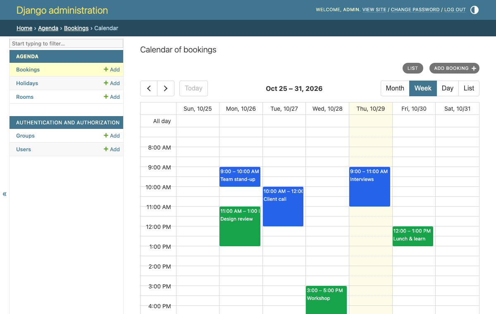
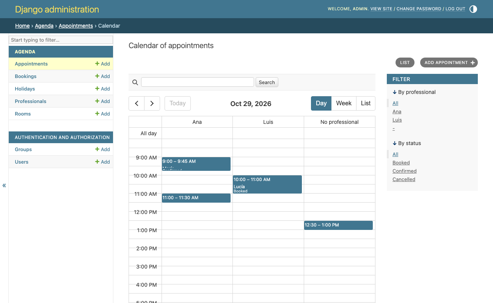
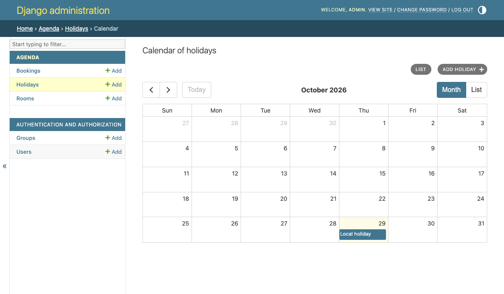
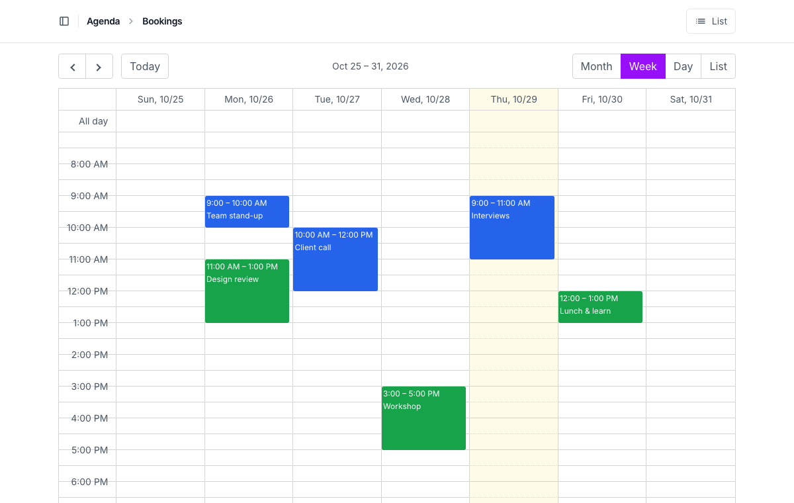
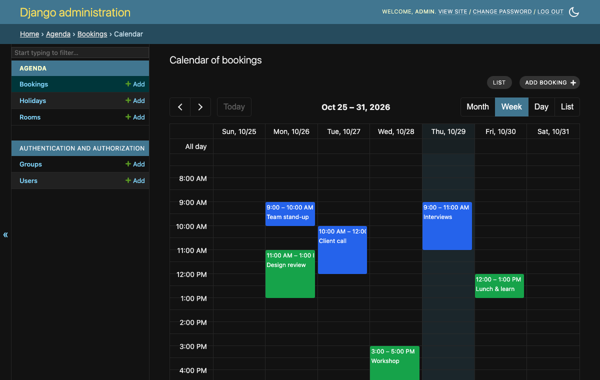
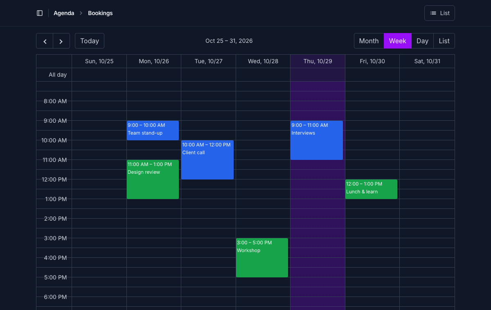
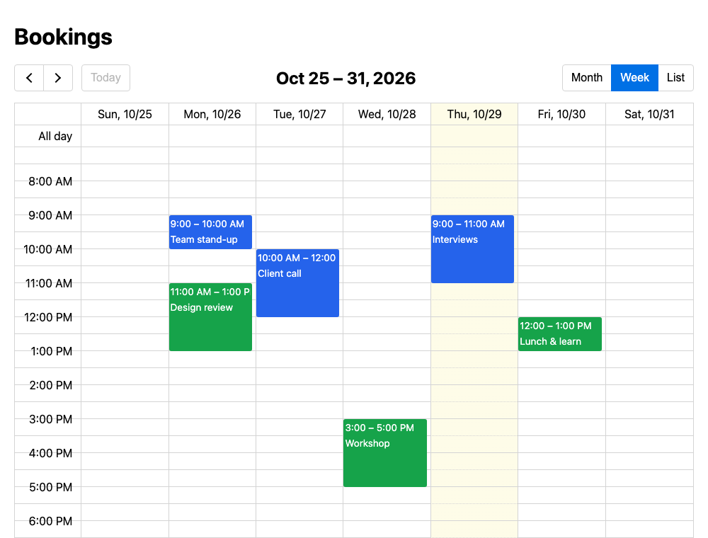

# django-ec-calendar

[](https://github.com/rodolvbg/django-ec-calendar/actions/workflows/pytest.yml)
[](https://github.com/rodolvbg/django-ec-calendar/actions/workflows/js-tests.yml)
[](https://pypi.org/project/django-ec-calendar/)
[](https://pypi.org/project/django-ec-calendar/)
[](https://pypi.org/project/django-ec-calendar/)
[](https://pepy.tech/project/django-ec-calendar)

A calendar for the Django admin and your own pages, with
[EventCalendar](https://github.com/vkurko/calendar) (by vkurko, MIT): a
changelist's objects by date — opened with a click, added by selecting the
dates, moved and resized by dragging — in Django's admin and in
[django-unfold](https://github.com/unfoldadmin/django-unfold), light and
dark.



## Install

```bash
uv add django-ec-calendar
# or
pip install django-ec-calendar
```

Add it to `INSTALLED_APPS` (so Django finds its templates, and
`django.contrib.staticfiles` its JS and CSS — EventCalendar included, no
CDN):

```python
INSTALLED_APPS = [
    ...,
    "django_ec_calendar",
]
```

## In the admin

```python
from django.contrib import admin
from django_ec_calendar import CalendarAdminMixin


@admin.register(Booking)
class BookingAdmin(CalendarAdminMixin, admin.ModelAdmin):
    list_filter = ("room",)
    search_fields = ("title",)
    calendar_start_field = "start"
    calendar_end_field = "end"  # optional
    calendar_color_field = "color"  # optional: a CSS color, a field or property
    calendar_view = "timeGridWeek"  # optional ("dayGridMonth")
    calendar_options = {"slotMinTime": "07:00"}  # optional: any of EventCalendar's
```

The changelist gets a "Calendar" link, next to "Add":

- **What it shows** is `get_calendar_queryset(request)`: what the changelist
  would (its `get_queryset()`, filters and search). Override it, calling
  `super()`, to restrict the calendar only. One query per range the
  calendar shows.
- **Its filters and search**: the changelist's, around it
  (`calendar_filters = False`: not). Filtering by a resource shows only its
  column.
- **A click** on an event opens its change page (read-only, for those who
  may only view it); after a save, back to the calendar, where it was.
- **Selecting dates** (or clicking one) opens the add page with them, and
  the column's resource, for those who may add (`calendar_selectable =
  False`: not). A click starts at its slot's start (9:20 in half-hour
  slots: 9:00).
- **Dragging** is off by default: a slip of the mouse would change an
  appointment. With `calendar_editable = True`, dragging an event, or its
  end, saves its dates (and its resource), asking first
  (`calendar_confirm_move = False`: not), for those who may change it. The
  move is checked by the model (`full_clean()` of what it changes, and its
  `clean()`), saved through `save_model()` and logged as the admin's
  changes are; what can't be saved goes back, saying why.
- **Where it was**: its view and date are in the page's URL (`ec-view`,
  `ec-date`), so the back button, a save, the filters and a shared link
  open it there (`calendar_url_state = False`: not).
- **Its views**: `calendar_views` — by default month, week, day and list
  (`dayGridMonth`, `timeGridWeek`, `timeGridDay`, `listMonth`; any of
  [EventCalendar's](https://github.com/vkurko/calendar#view), the
  resources' and timelines' included, all translated).
- **Today** is tinted, but not in a day's view (`calendar_highlight_today =
  False`: never).

### In the menu

The calendar's URL is `admin:<app>_<model>_calendar`. In Unfold's sidebar,
`calendar_navigation()` gives a model's list and its calendar, each marked
active on its own page (Unfold would mark the list active on both):

```python
from django_ec_calendar.unfold import calendar_navigation

UNFOLD = {
    "SIDEBAR": {
        "navigation": [
            {
                "title": "Agenda",
                "items": calendar_navigation(
                    "agenda.Appointment", calendar_title="Appointments' calendar"
                ),
            },
        ],
    },
}
```

`calendar_item()` and `changelist_item()` are each of them alone (with
`title`, `icon` and `site`); both are only for those who may view or
change the model's objects.

### Its fields

| Option | |
|---|---|
| `calendar_start_field` | A `DateTimeField` (events at a time) or a `DateField` (all-day events). Required. |
| `calendar_end_field` | Where it ends (none: it lasts no time, or its day; it can't be resized). |
| `calendar_duration_field` | How long it lasts, instead of an end: minutes (an integer field) or a `DurationField`. Resizing changes it. Events that start up to `calendar_max_duration` (a day) before the calendar's range are looked for. |
| `calendar_all_day_field` | A `BooleanField`: true, an all-day event of a `DateTimeField`. |
| `calendar_title_field` | Its title (none: `str(obj)`). |
| `calendar_color_field` | Its color, a CSS color (none: the admin's). |
| `calendar_detail_fields` | More lines of text under its title: fields, methods or properties of the model, or the admin's methods, as in `list_display` (`("room", "get_status_display")`). Text only, never HTML. |
| `calendar_resource_field` | Its resource: a `ForeignKey`, a `ManyToManyField` (in several) or a field with `choices`. See below. |

`get_calendar_event(request, obj)` makes the whole event (any of
[EventCalendar's event](https://github.com/vkurko/calendar#event-object)
properties), calling `super()`.

### Resources

With `calendar_resource_field`, the resource views (`resourceTimeGridDay`,
`resourceTimeGridWeek`, `resourceTimelineDay`… in `calendar_views`) have a
column, or a row, per resource:

```python
@admin.register(Appointment)
class AppointmentAdmin(CalendarAdminMixin, admin.ModelAdmin):
    list_filter = ("professional", "status")
    calendar_start_field = "start"
    calendar_duration_field = "minutes"
    calendar_resource_field = "professional"
    calendar_detail_fields = ("get_status_display",)
    calendar_view = "resourceTimeGridDay"
    calendar_views = ("resourceTimeGridDay", "resourceTimeGridWeek", "listWeek")
    calendar_editable = True

    def get_calendar_queryset(self, request):
        # The calendar only: not the cancelled ones.
        return super().get_calendar_queryset(request).exclude(status="cancelled")
```

- **The resources** are the objects a foreign key or a many-to-many field
  may point to (its `limit_choices_to`), or a field's choices; and, when an
  event may have none (a nullable or blank field), one more for those:
  "No professional" (`calendar_resource_empty_label`). Override
  `get_calendar_resources(request)` for others (`{id, title}`, any of
  [EventCalendar's](https://github.com/vkurko/calendar#resource-object)).
- **Each event** is in its own (`resourceIds`; with many-to-many, in each).
- **Adding** in a column fills its resource (`?professional=3`).
- **Dragging** to another column changes its resource too, checked as the
  rest; with many-to-many, from the one it was dragged from to the other
  (`calendar_resource_editable = False`: its resource can't change).



### Days

A `DateField`'s end is the last day (EventCalendar's is the day after: it's
converted both ways).



### Business hours

When it's open, and the rest shaded:

```python
class AppointmentAdmin(CalendarAdminMixin, admin.ModelAdmin):
    ...
    calendar_business_hours = [
        {"days": [1, 2, 3, 4, 5], "start": "09:00", "end": "14:00"},
        {"days": [1, 2, 3, 4, 5], "start": "16:00", "end": "20:00"},
    ]
    calendar_outside_hours = "block"  # or "shade" (the default)

    def get_calendar_business_hours(self, request, resource=None):
        # The user's, the business', each professional's (resource: its id)…
        return request.user.profile.hours or super().get_calendar_business_hours(
            request, resource
        )

    def get_calendar_closed(self, request, start, end, resource=None):
        # Holidays, a professional's days off…: (start, end), datetimes or dates.
        holidays = Holiday.objects.filter(date__gte=start, date__lt=end)
        return [(day.date, day.date + timedelta(days=1)) for day in holidays]
```

- **Days** are counted as JavaScript does (Sunday 0); without them, every
  day. `"24:00"` is the end of the day.
- **What's closed** (out of the hours, and `get_calendar_closed()`) comes
  with the events, as background events (class
  `django-ec-calendar-closed`): the calendar's in its views, and each
  resource's in its column. Whole days show in the month views too.
- **Fitted**: the time views go from the first time it opens to the last,
  without the days it's closed (`calendar_fit_hours = False`: not; your
  `calendar_options` win).
- **`"block"`**: what's closed can't be selected, clicked, nor moved to —
  in the browser, and checked by the server for moves
  (`is_calendar_open(request, start, end, resource)`, for your own forms
  too). The add page itself isn't restricted.
- It's the calendar's, by the site's wall-clock time (its time zone). Each
  request, and each resource, may have its own: nothing is assumed of where
  they're kept.

### Each request

Each option has a method that takes the request, as the admin's
`get_list_display()`:

| Method | Default |
|---|---|
| `get_calendar_queryset(request)` | The changelist's objects. |
| `get_calendar_view(request)`, `get_calendar_views(request)` | `calendar_view`, `calendar_views`. |
| `get_calendar_options(request)` | `calendar_options`: any other of EventCalendar's options, over those fitted to the hours. Only what's shown: what the server allows has its own methods. |
| `get_calendar_detail_fields(request)` | `calendar_detail_fields`. |
| `get_calendar_business_hours(request, resource=None)`, `get_calendar_closed(request, start, end, resource=None)` | `calendar_business_hours`; none. |
| `get_calendar_resources(request)`, `get_calendar_resource_empty_label(request)` | Its field's; "No …". |
| `get_calendar_resource_editable(request)` | `calendar_resource_editable`. |
| `get_calendar_confirm_move(request)`, `get_calendar_filters(request)`, `get_calendar_url_state(request)`, `get_calendar_highlight_today(request)` | Their attributes. |
| `has_calendar_move_permission(request, obj=None)` | `calendar_editable`, and one may change it. |
| `has_calendar_add_permission(request)` | `calendar_selectable`, and one may add. |

```python
def has_calendar_move_permission(self, request, obj=None):
    # Each professional moves their own.
    allowed = super().has_calendar_move_permission(request, obj)
    return allowed and (obj is None or obj.professional.user == request.user)
```

The browser and the server ask the same methods. The whole configuration
the script reads is `get_calendar_config(request)`.

The fields (`calendar_start_field`, `calendar_end_field`,
`calendar_duration_field`, `calendar_resource_field`…) are the model's,
the same for every request: what's shown, moved and saved must be the same
fields.

### Time zones

Times show as the wall-clock time of Django's current time zone, and are
saved so, whatever the browser's: an event at 10:00 in Madrid shows at
10:00 to someone in New York too. "Today" and the time now are the site's.

### Unfold, dark

With Unfold, in its colors, and next to its buttons. In both, the calendar
follows the page's theme, light or dark (the admin's theme switch,
Unfold's), else the system's.







## On your pages

A view with the events, as the calendar asks for them:

```python
from django_ec_calendar import EventFeedView


class BookingEvents(EventFeedView):
    queryset = Booking.objects.select_related("room")  # or model, get_queryset()
    calendar_start_field = "start"
    calendar_end_field = "end"
    calendar_color_field = "color"
```

```python
urlpatterns = [path("events/", BookingEvents.as_view(), name="booking-events")]
```

Each event leads to the object's `get_absolute_url()` (override
`get_calendar_event_url(obj)`). Who may see them is the view's own
business: `LoginRequiredMixin`, `get_queryset()`… The fields above work
here too; with `calendar_resource_field`, `?resources=1` answers its
resources.

And the calendar, in a template:

```django

<head>
  ...
  
</head>
<body>
  
  
</body>
```

`views` are separated by spaces (empty: none to switch to);
`resources=True` fetches the resources from the same view; `url_state=False`
leaves the page's URL alone, and `highlight_today=False` never tints today.
Any other keyword is one of EventCalendar's options. On a page it's
read-only.



### Its events, for doing otherwise

Before it does what it does, the calendar fires an event on its element,
which bubbles and can be cancelled — `preventDefault()`, and it isn't done
— with the dates as the server reads them:

| Event | `detail` | Otherwise |
|---|---|---|
| `django-ec-calendar:event-click` | `event` (EventCalendar's), `url`, `jsEvent` | Opens `url`. |
| `django-ec-calendar:date-click` | `start`, `allDay`, `resource`, `jsEvent` | Opens the add page. |
| `django-ec-calendar:select` | `start`, `end`, `allDay`, `resource`, `jsEvent` | Opens the add page. |
| `django-ec-calendar:event-change` | `event`, `saved`, `error` | (After a move; not cancellable.) |

```js
document.addEventListener("django-ec-calendar:event-click", (event) => {
    event.preventDefault();
    openDialog(event.detail.url);  // A dialog, instead of a page.
});
```

They fire without an add page too (on your pages, `selectable: true` in the
options for selections).

The script makes every `[data-django-ec-calendar]` on the page;
`window.djangoEcCalendar.setup()` makes those added later, and
`window.djangoEcCalendar.go` is where a click leads (a single-page app's
router, instead of a page load).

## Content Security Policy

It works under a strict policy (`script-src 'self'; style-src 'self'`, no
`'unsafe-inline'`): each calendar's configuration is a JSON data block
(`json_script`, which `script-src` doesn't run), read by the package's own
script, and EventCalendar sets its elements' styles through the CSSOM
(which `style-src` doesn't restrict).

## Translations

Ships a Spanish (`es`) translation; the days' and months' names come from
the browser, in the request's language, and the first day of the week from
Django's `FIRST_DAY_OF_WEEK`.

## EventCalendar

[EventCalendar](https://github.com/vkurko/calendar) 5.17.1's standalone
build is included as it's published
(`static/django_ec_calendar/vendor/event-calendar/`, with its MIT
license). Its options are documented in
[its README](https://github.com/vkurko/calendar#options).

## Supported versions

Django 4.2 – 6.1, Python 3.10+.

## Development

See [CONTRIBUTING.md](CONTRIBUTING.md) for setup, running the example
project, and the test/lint/type-check commands.
